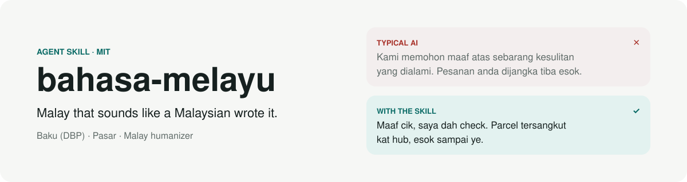
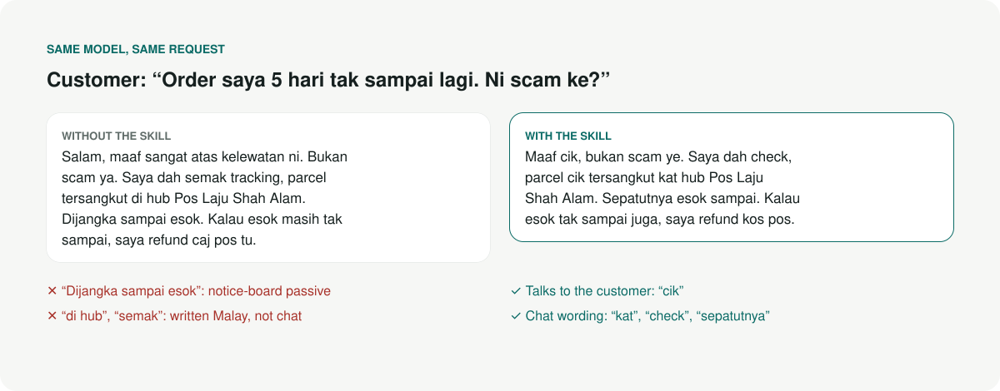

<picture>
  <source media="(prefers-color-scheme: dark)" srcset="assets/banner-dark.svg">
  
</picture>

# bahasa-melayu

An agent skill (Claude Code, Codex and any tool that reads `SKILL.md`) that writes **natural Malaysian Malay** in the right register, then checks it for the habits that make AI Malay sound like AI.

It covers both registers Malaysians actually use:

- **Bahasa baku** follows Dewan Bahasa dan Pustaka (DBP) rulings. Use it for letters, formal email, CVs, reports and UI text.
- **Bahasa basahan** is everyday Malay. Use it for WhatsApp, customer DMs, captions, and chat with family and friends.

## Why

Language models write Malay that is grammatical but obviously not human:

- `anda` in a message to your wife
- `Ia adalah penting untuk…` (an English sentence in Malay words)
- `Semoga membantu!` at the end of everything
- `lah` on every sentence when the model tries to sound casual
- Indonesian words leaking in (`bisa`, `aja`, `banget`)

Some Indonesian leaks are offensive in Malaysia (`butuh`, `gampang`). As of November 2026 no public skill covered both registers with a Malay-specific humanizer pass.

## Case study: same model, with and without the skill

<picture>
  <source media="(prefers-color-scheme: dark)" srcset="assets/case-study-dark.svg">
  
</picture>

**Method.** On 25 Nov 2026 we gave Claude Opus 5.5 the same six everyday requests twice:
- once with no skill and no style hints
- once with this skill

The outputs below are unedited. The verdicts are the author's, a native KL speaker.

**Result: the skill was better in 4 of 6 cases and tied in 2. It was never worse.** Modern models already write decent casual Malay. The skill fixes register slips: formal phrasing in customer chats, letter formulas in email, and English sentence shapes in translations.

| # | Request | Without the skill | With the skill | Verdict |
|---|---|---|---|---|
| 1 | WhatsApp to wife: leaving in 10 min, will buy diapers | Belum lagi sayang. Lagi 10 minit abang keluar ofis. Nanti abang singgah farmasi beli lampin ye. | Belum yang, lagi 10 minit abang keluar office. Nanti abang singgah farmasi beli lampin ye | Tie: both natural |
| 2 | Hobby-shop DM: "Boss, kit ni ada lagi? Boleh pos ke Kuching?" | Ada lagi boss, tinggal 2 unit je. Boleh pos ke Kuching, caj pos ke Sarawak RM15. Barang saya pos hari bekerja berikutnya. | Salam boss, kit ni ada lagi, tinggal 2 je. Boleh pos ke Kuching, kos pos ke Sarawak RM15. Lepas bayar, saya pos next working day ya 😊 | **Skill.** "hari bekerja berikutnya" reads like a notice; the skill uses a seller's opener and close |
| 3 | Complaint: "Order saya 5 hari tak sampai lagi. Ni scam ke?" | Salam, maaf sangat atas kelewatan ni. Bukan scam ya. Saya dah semak tracking, parcel tersangkut di hub Pos Laju Shah Alam. Dijangka sampai esok. Kalau esok masih tak sampai, saya refund caj pos tu. | Maaf cik, bukan scam ye. Saya dah check, parcel cik tersangkut kat hub Pos Laju Shah Alam. Sepatutnya esok sampai. Kalau esok tak sampai juga, saya refund kos pos. | **Skill.** It addresses the customer, and "Dijangka sampai esok" was a notice-board passive |
| 4 | Email to manager: work from home on Friday | Two greetings ("Assalamualaikum dan salam sejahtera"), a Title Case subject, and the letter sign-off "Yang benar" | "Salam Puan Rosmah", a sentence-case subject with the actual date, "Salam hormat" | **Skill.** A modern office email, not a letter pasted into an email |
| 5 | Friends' group: futsal Thursday 9pm, RM10 each | Geng, futsal Khamis ni pukul 9 malam. Court dah book kat Kelana Jaya. RM10 sorang. Siapa join? Tulis nama 👇 | Weh, futsal Khamis ni 9 malam. Aku dah book court kat Kelana Jaya, RM10 sorang. Siapa on? | Tie: the version without the skill is arguably better |
| 6 | Landing page: "Track your expenses in seconds. No spreadsheets, no stress." | Rekod perbelanjaan anda dalam beberapa saat. Tiada spreadsheet, tiada tekanan. | Catat perbelanjaan dalam beberapa saat. Tak perlu spreadsheet, tak perlu pening kepala. | **Skill.** It uses a natural Malay idiom instead of copying the English parallel |

Six requests make a small sample. Run your own before you trust it, and open an issue with what you find.

## What's inside

| File | What it holds |
|---|---|
| `SKILL.md` | The workflow: pick the register, fix the pronouns, think in Malay, draft, run a two-layer humanizer pass, read it aloud. |
| `references/register-guide.md` | Situation → register (R1 official → R4 close friends), with pronouns, particles, code-switching, spelling, and 9 worked scenarios. |
| `references/baku.md` | DBP grammar: sentence patterns, hukum D-M, active/passive, affixes, prepositions (`dari`/`daripada`), common errors, spelling, Malaysian vs Indonesian vocabulary, letter and email conventions. About 80 DBP rulings are cited by keyword and date. |
| `references/basahan.md` | Particles (`la, kan, ke, je, pun, kot, pulak, tau…`) with meaning and position, short forms, pronouns by relationship, code-switching, slang, regional markers, tone ladders. §8a has measured norms from about 12,000 real adult chat messages. |
| `references/malay-ai-tells.md` | The Malay humanizer: structural tells in their Malay form, translation artefacts, Indonesian leakage, register mismatch, fake-basahan overcorrection, and a final checklist. |

## Install

**Claude Code**

```bash
git clone https://github.com/aizadshafeez/bahasa-melayu-skill ~/.claude/skills/bahasa-melayu
```

**Codex / other agents:** clone it into your agent's skills folder (e.g. `~/.agents/skills/bahasa-melayu`).

The skill triggers on its own whenever you ask for anything in Malay. Optionally, install a general humanizer skill too; this skill runs it as its first check if present, and falls back to its own Malay checklist if not.

## Make it sound like you (optional)

Create a `voice.md` next to `SKILL.md` describing how you write Malay to specific people: which pronouns, how much you shorten, your particles and emoji. The skill uses it whenever it drafts as you. `voice.md` is listed in `.gitignore`, so it stays on your machine.

## Sources and honesty

Every rule is tagged with where it came from:

- `[KN:keyword date]`: a DBP Khidmat Nasihat ruling (prpm.dbp.gov.my)
- `[NK]`: native-speaker convention, with no published source
- `[CORPUS]`: measured from a consenting native speaker's own chats, aggregates only, no real messages
- `(perlu semakan)`: the sources conflict; the file says which form is safer

A few findings differ from school textbooks. DBP accepts `sangat … sekali`. It allows `adalah` before an adjective phrase. And a 2013 ruling says `justeru` does not mean `oleh itu`.

Most of the basahan material is native judgement, because DBP treats colloquial Malay as non-standard and academic work covers only a few particles. It was reviewed by a native KL speaker. Corrections are very welcome.

Not affiliated with or endorsed by Dewan Bahasa dan Pustaka.

## Contributing

Open an issue or a pull request, especially for:

- a rule that sounds wrong to a native ear (say where you're from)
- dialect sections (northern, Kelantan/Terengganu, Negeri Sembilan, Sabah, Sarawak), kept separate from the KL default
- newer DBP rulings that settle a `perlu semakan` item

## Credits

Material was taken and corrected from two MIT-licensed skills: [`dbp-translator-claude`](https://github.com/keemanxp/dbp-translator-claude) by Kee-Man Chuah, and [`i18nstack` `localize-ms`](https://github.com/i18n-agent/i18nstack) by i18nagent.ai. See [THIRD_PARTY_NOTICES.md](THIRD_PARTY_NOTICES.md).

---

## Ringkasan (BM)

Skill ini membantu AI menulis Bahasa Melayu Malaysia yang bunyinya macam orang betul-betul tulis: baku untuk surat dan e-mel rasmi, basahan untuk WhatsApp dan media sosial. Lepas tu ia semak tulisan tu supaya tak bunyi macam terjemahan mesin atau bahasa Indonesia.

Peraturan baku merujuk Khidmat Nasihat DBP. Bahagian basahan pula disemak oleh penutur asli dari KL. Kalau ada yang tak kena, buka issue ye.

## License

MIT. See [LICENSE](LICENSE).
