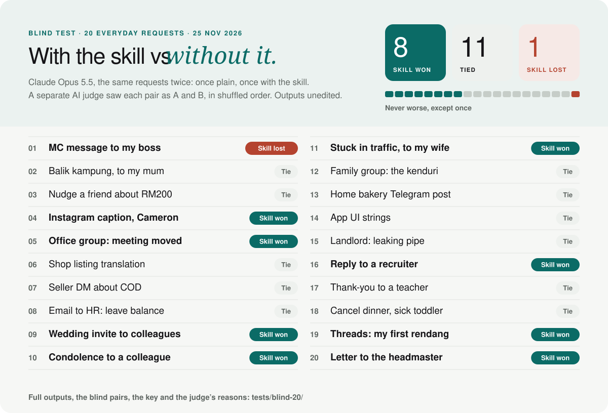

<picture>
  <source media="(prefers-color-scheme: dark)" srcset="../../assets/blind-test-dark.svg">
  
</picture>

# Blind test: 20 everyday requests

The first case study in the main README used six requests, which is a small sample. This test adds twenty more and takes the author out of the judging.

## Method

1. **Twenty requests** written on 25 Nov 2026 ([`requests.md`](requests.md)), covering the situations Malaysians actually write in: WhatsApp to family, colleagues and a boss, group chats, customer DMs, captions, app strings, an HR email and a formal school letter.
2. **Two runs, same model.** Claude Opus 5.5 answered every request twice: once with no skill and no style hints ([`without.md`](without.md)), once with bahasa-melayu v1.1.0 ([`with.md`](with.md)).
3. **Blind pairs.** Each pair was labelled A and B in a shuffled order ([`blind.md`](blind.md)). The key that says which letter used the skill was kept apart ([`key.json`](key.json)).
4. **A separate judge.** A separate AI agent, which had never seen the skill, picked A, B or a tie for each pair and gave a reason ([`verdicts.md`](verdicts.md)). Only then was the key applied.

All outputs are unedited. Names in the requests are made up.

## Result

**The skill won 8, tied 11 and lost 1.** Modern models already write decent casual Malay, so most everyday chat ties. The skill wins where register matters: memo language in a chat group, letter formulas, English sentence shapes, Indonesian-leaning words, and `aku/kau` with a colleague.

| # | Request | Result | Why (the judge's reason, in short) |
|---|---|---|---|
| 1 | WhatsApp to my boss: on MC with a fever | **Skill lost** | “Puan call je ye” is too casual for a boss, and “Maaf atas kesulitan” is stiff |
| 2 | WhatsApp to my mum: balik kampung on Saturday | Tie | Both natural |
| 3 | Nudge a close friend about RM200 | Tie | Both read like real friend chat |
| 4 | Instagram caption, family trip to Cameron | **Skill won** | Reads like a real caption; the other is copywriter polish |
| 5 | Office group: meeting moved to 3pm | **Skill won** | The other is a memo in a chat group (“Makluman… telah dianjakkan”) |
| 6 | Shop listing translation | Tie | Both standard |
| 7 | Seller reply about COD at the LRT | Tie | Both natural seller replies |
| 8 | Email to HR about leave balance | Tie | Both fine; the other is slightly translated |
| 9 | Wedding invite to colleagues | **Skill won** | The other is stiff and uses Indonesian-leaning “kalian” |
| 10 | Condolence to a colleague | **Skill won** | The other uses `aku/kau` with a colleague and an English calque |
| 11 | Stuck in traffic, to my wife | **Skill won** | “Yang, abang stuck jem kat Federal” is how husbands text |
| 12 | Family group: what I’m bringing to the kenduri | Tie | Both natural |
| 13 | Home bakery Telegram post | Tie | Both believable for a channel |
| 14 | App UI strings | Tie | Identical and correct |
| 15 | Landlord: the kitchen pipe is leaking | Tie | Both polite and natural |
| 16 | Reply to a recruiter on LinkedIn | **Skill won** | Concise; the other pads it (“Namun begitu, saya amat berbesar hati…”) |
| 17 | Thank-you to my daughter’s teacher | Tie | Both sendable |
| 18 | Cancel dinner, sick toddler | Tie | Both natural |
| 19 | Threads post: my first rendang | **Skill won** | Sounds native; the other has an English sentence shape (“dan jadi!”) |
| 20 | Formal letter to the headmaster | **Skill won** | Cleaner baku with the date and days filled in; the other uses “adalah dirujuk” |

## What the loss taught

Request 1 is a real gap: a short WhatsApp to a boss needs the respect of an email in the brevity of a chat. The skill went too casual, then closed with a stock apology. It is the next fix.

## Limits

- Twenty requests is still a small sample, and one judge is one opinion.
- The judge is an AI agent, not a panel of native speakers. The six pairs in the main README were judged by the author, a native KL speaker.
- Run your own test before you trust it, and open an issue with what you find.
